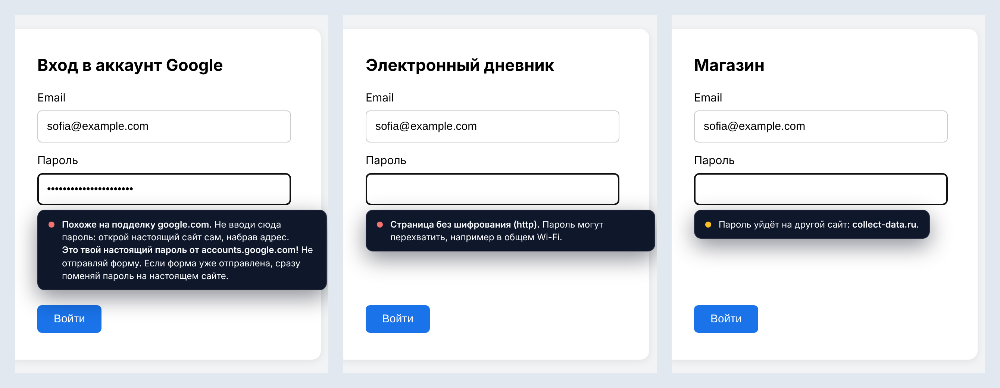
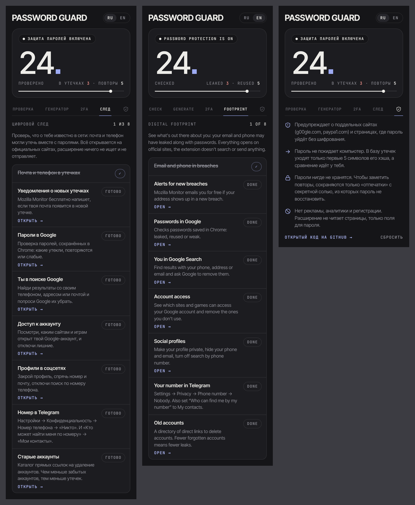
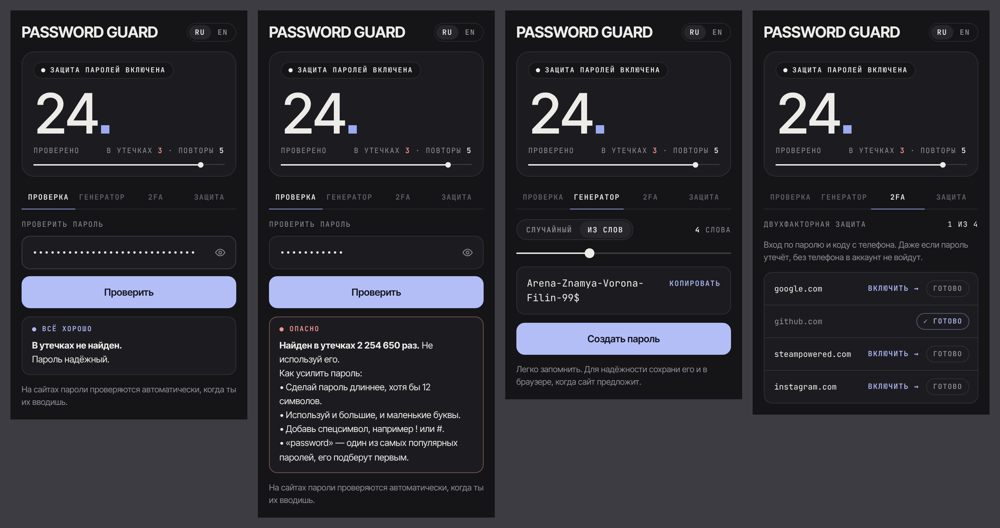
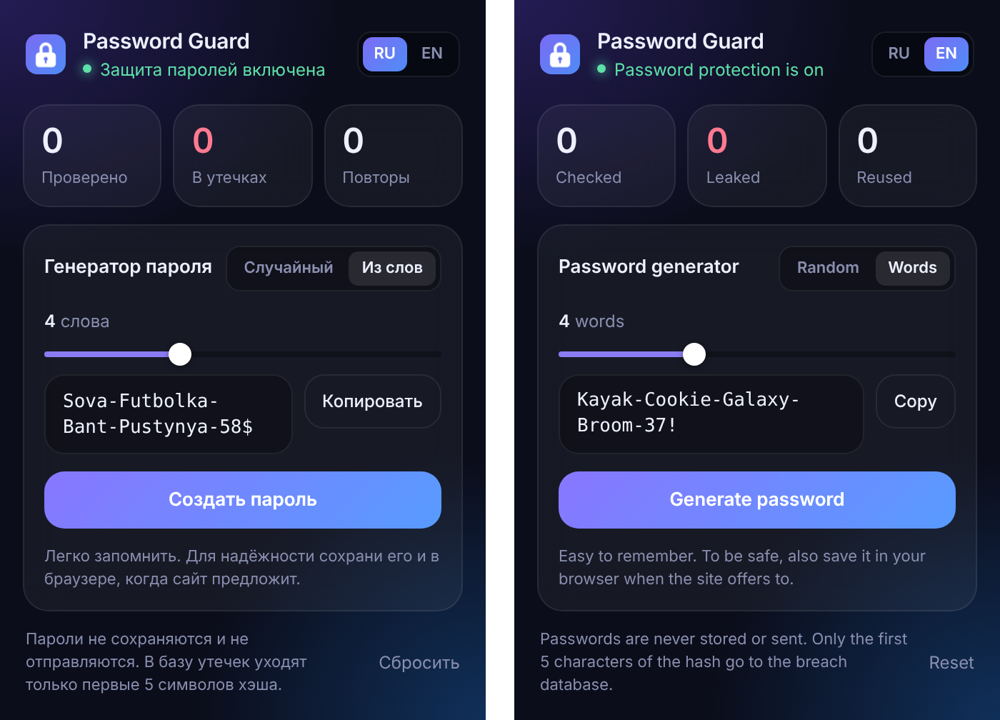
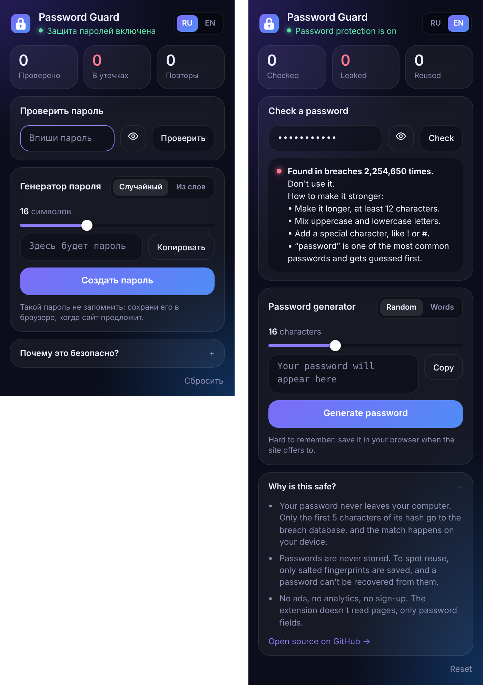

# Password Guard

A browser extension that warns you, while you type, if your password has appeared in a data breach or is reused on other sites.

## Features
- **Breach check.** Looks the password up in [Have I Been Pwned](https://haveibeenpwned.com/Passwords) (900M+ leaked passwords) without ever sending it.
- **Fake site warning.** Before you type, it checks the address for lookalikes of popular services: typos (`gtihub.com`), swapped characters (`g00gle.com`, `paypa1.com`, `rnicrosoft.com`), brand names hidden in subdomains (`paypal.com.secure-login.xyz`), letters from other alphabets (punycode) and raw IP addresses. If you type your real password for a site into its fake copy, it tells you to stop and change it.
- **Unsafe form warning.** Warns when a page has no encryption (http), when a form would send the password unencrypted, or when it would send it to a different site.
- **Two-factor reminder.** On sites like Google, Instagram, Steam or GitHub it reminds you to turn on two-factor login. The 2FA tab lists the sites you use with a direct link to the right settings page, and you can tick them off.
- **Digital footprint (self-check).** A checklist for your *own* data: see whether your email or phone appeared in breaches (via the official Have I Been Pwned site), turn on breach alerts, remove your phone or address from Google Search, close social profiles, hide your number in Telegram, delete old accounts. Each step links to the official page; the extension never looks anyone up.
- **Reuse warning.** Notices when the same password is used on several sites.
- **Strength tips.** Explains what makes a password weak: length, missing character types, common passwords, keyboard runs, repeated characters, years.
- **Manual check.** Type any password into the popup to see if it has leaked and how strong it is. Nothing is saved.
- **"Why is this safe?"** A short explanation right in the popup, with a link to this source code.
- **Generator.** Two modes: a random password (8–32 characters), or an easy-to-remember passphrase of 3–6 random words like `Kayak-Cookie-Galaxy-Broom-37!` (Russian words are written in Latin letters so every site accepts them). Uses `crypto.getRandomValues`.
- **English and Russian.** Switch the language with the RU / EN toggle in the popup; warnings on websites follow it instantly.

## How the breach check stays private
1. The extension computes the SHA-1 hash of the password locally.
2. Only the first 5 hex characters are sent to `api.pwnedpasswords.com/range/<prefix>` (k-anonymity), with response padding enabled.
3. The API returns every leaked hash with that prefix (hundreds of them), and the match is done on your device.

For reuse detection, the extension stores a salted SHA-256 fingerprint per site in local extension storage. Plain passwords are never stored. See [PRIVACY.md](PRIVACY.md).

## Install
Works in Chrome, Edge, Brave and other Chromium browsers.
1. Click **Code → Download ZIP** on this page and unzip it.
2. Open `chrome://extensions` (or `edge://extensions`) and turn on Developer mode.
3. Click "Load unpacked" and choose the `extension` folder.
4. Open any login page and start typing a password. Try `password123` to see a leak warning.

## Project structure
| File | What it does |
|---|---|
| `extension/content.js` | Finds password fields and shows the warning under them |
| `extension/background.js` | Breach lookup (k-anonymity) and salted reuse fingerprints |
| `extension/strength.js` | Password strength rules |
| `extension/generator.js` | Secure password and passphrase generator |
| `extension/words.js` | Word lists for passphrases (English and Russian) |
| `extension/popup.*` | Toolbar popup with stats, the generator and the language toggle |
| `extension/i18n.js` | English and Russian interface texts |
| `extension/tests.html` | Open in a browser to run the unit tests (18 checks) |

## Tech
JavaScript, Chrome Extensions Manifest V3 (with `_locales` for English and Russian), Web Crypto API, Have I Been Pwned range API.

## Why I built it
Most people I know use one or two passwords for everything, and almost nobody checks whether those passwords have already leaked. I wanted a tool that catches this at the exact moment it matters: when you are typing the password. The hardest part was making it private. A password checker that sends your password somewhere is itself a risk, so I used the k-anonymity range API and salted fingerprints, so the extension can warn you without ever knowing or storing your actual passwords.

This is my second cybersecurity project after a [phishing email detector](https://github.com/geo777arm/phish-detector).

## Author
[geo777arm](https://github.com/geo777arm). Also see my [phishing email detector](https://github.com/geo777arm/phish-detector).

Fonts: [Inter Tight](https://fonts.google.com/specimen/Inter+Tight) and [JetBrains Mono](https://fonts.google.com/specimen/JetBrains+Mono), both under the SIL Open Font License, bundled in `extension/fonts/` so nothing is loaded from the internet.
