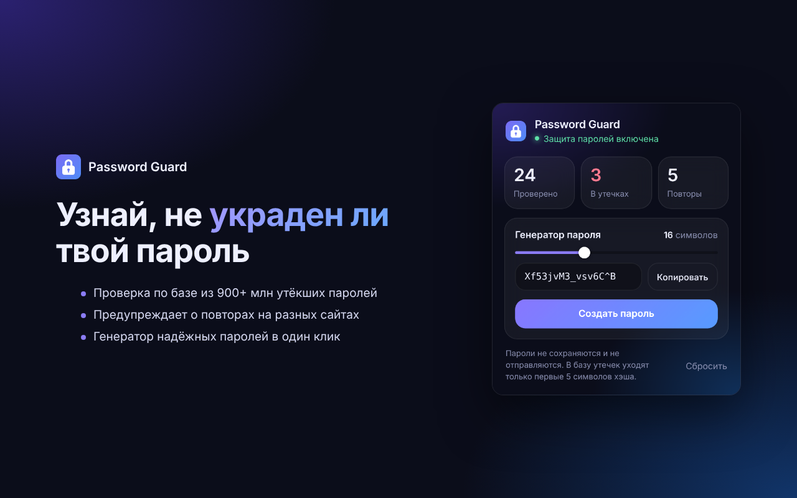
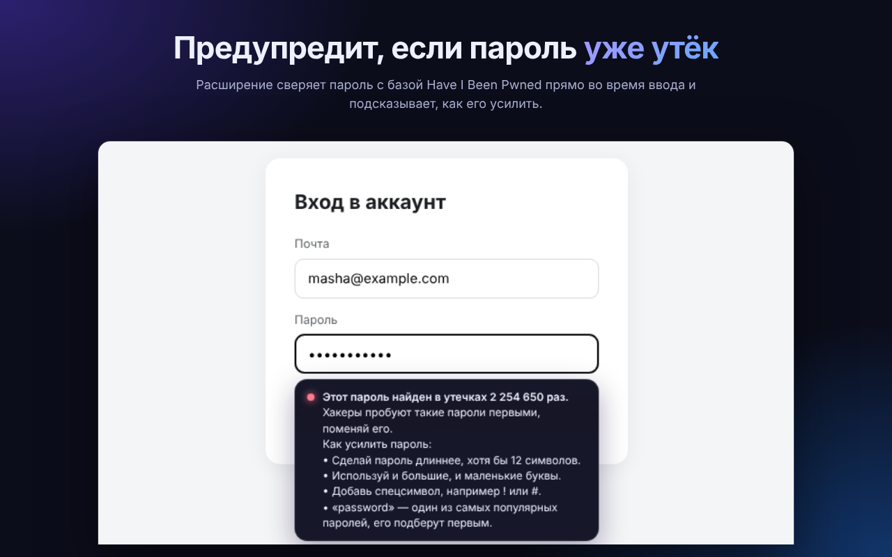

# Password Guard

A browser extension that warns you, while you type, if your password has appeared in a data breach or is reused on other sites.

## Features
- **Breach check.** Looks the password up in [Have I Been Pwned](https://haveibeenpwned.com/Passwords) (900M+ leaked passwords) without ever sending it.
- **Reuse warning.** Notices when the same password is used on several sites.
- **Strength tips.** Explains what makes a password weak: length, missing character types, common passwords, keyboard runs, repeated characters, years.
- **Generator.** Creates a strong random password with `crypto.getRandomValues`.

## How the breach check stays private
1. The extension computes the SHA-1 hash of the password locally.
2. Only the first 5 hex characters are sent to `api.pwnedpasswords.com/range/<prefix>` (k-anonymity), with response padding enabled.
3. The API returns every leaked hash with that prefix (hundreds of them), and the match is done on your device.

For reuse detection, the extension stores a salted SHA-256 fingerprint per site in local extension storage. Plain passwords are never stored. See [PRIVACY.md](PRIVACY.md).

## Install
Works in Chrome, Edge, Brave and other Chromium browsers.
1. Click **Code → Download ZIP** on this page and unzip it.
2. Open `chrome://extensions` (or `edge://extensions`) and turn on Developer mode.
3. Click "Load unpacked" and choose the `extension` folder.
4. Open any login page and start typing a password. Try `password123` to see a leak warning.

## Project structure
| File | What it does |
|---|---|
| `extension/content.js` | Finds password fields and shows the warning under them |
| `extension/background.js` | Breach lookup (k-anonymity) and salted reuse fingerprints |
| `extension/strength.js` | Password strength rules |
| `extension/generator.js` | Secure password generator |
| `extension/popup.*` | Toolbar popup with stats and the generator |
| `extension/tests.html` | Open in a browser to run the unit tests (15 checks) |

## Tech
JavaScript, Chrome Extensions Manifest V3, Web Crypto API, Have I Been Pwned range API.

## Why I built it
Most people I know use one or two passwords for everything, and almost nobody checks whether those passwords have already leaked. I wanted a tool that catches this at the exact moment it matters: when you are typing the password. The hardest part was making it private. A password checker that sends your password somewhere is itself a risk, so I used the k-anonymity range API and salted fingerprints, so the extension can warn you without ever knowing or storing your actual passwords.

This is my second cybersecurity project after a [phishing email detector](https://github.com/geo777arm/phish-detector).

## Author
[geo777arm](https://github.com/geo777arm). Also see my [phishing email detector](https://github.com/geo777arm/phish-detector).
